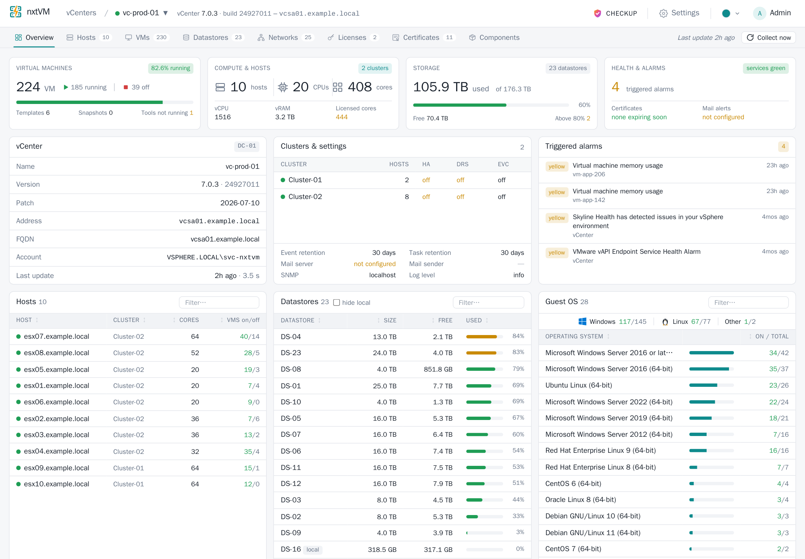
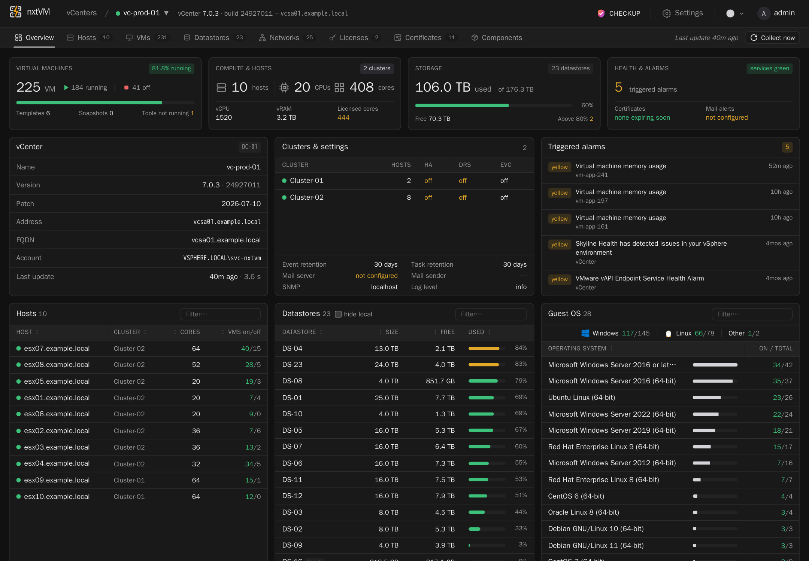
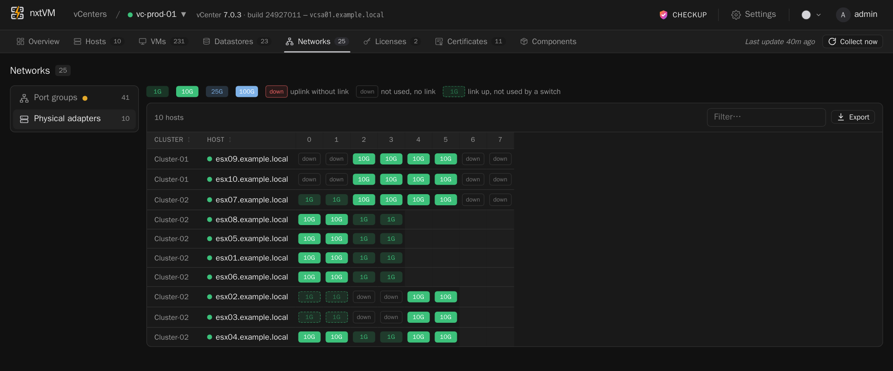
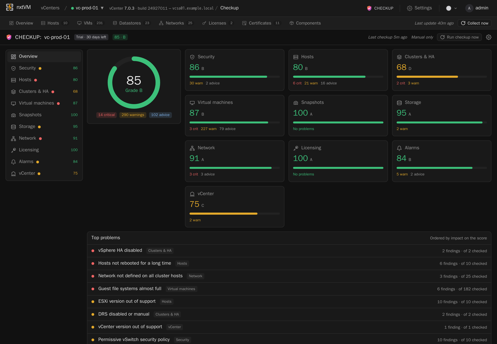

# nxtVM

**Multi-vCenter inventory and AI-assisted health monitoring for VMware vSphere.**

nxtVM brings all of your vCenter Servers together on one screen. It collects the inventory of every vCenter at
regular intervals and shows it the way a VMware administrator needs it: searchable, comparable and ready to export.
Its **Checkup** module continuously reviews that inventory against best practices, scores the health of each
vCenter and — with the help of AI — explains what deserves attention and how to fix it.

Collecting is **read-only**: nxtVM never changes anything in your vSphere environment.



<sub>Screenshots with sample names and addresses.</sub>

<details>
<summary><b>More screenshots</b> — dark mode, physical adapters, Checkup</summary>

**Overview in dark mode**



**Physical adapters** — link speed and state of every vmnic per host



**Checkup** — health score per vCenter and category, top problems ranked by impact



</details>

## Features

### Inventory
- **Every vCenter, one view** — all vCenter Servers side by side, or one at a time (`/vc/{id}/…`).
- **Overview** per vCenter: VMs, compute, storage, alarms, clusters and settings, hosts, datastores, guest OS mix.
- **Hosts, VMs, datastores** with detail pages (hardware, storage paths, NICs, snapshots, certificates…).
- **Networks**: port group × host matrix (missing port groups, VLAN mismatches), distributed switches and a
  **physical adapter** grid (link speed and state of every vmnic, driver, MAC, uplink role).
- **Licenses, certificates, vCenter components**.
- Column filters, sorting, totals and **Excel / CSV export** of exactly what is shown.

### AI-assisted health monitoring (Checkup)
- **74 checks in 10 categories** — vCenter, clusters, hosts, VMs, snapshots, storage, networking, security,
  licenses and alarms — run on a schedule or on demand.
- A **health score** per vCenter and category, with findings ranked by severity and concrete recommendations.
- **Ask AI** on any finding: nxtVM builds a precise prompt (versions, affected objects, the rule and its advice) and
  opens it in **Claude**, **ChatGPT** or **Gemini** in the user's own browser. Nothing is sent from the server, and
  object names can be anonymized before they leave the page.

### Operations
- Per-vCenter collection intervals, "Collect now", connection tests.
- Users with admin and standard roles, light and dark themes, audit log of every change.

## Editions

| Edition | What you get |
|---|---|
| **Trial** | Everything, for 30 days after installation. |
| **Free** | Inventory, overview and exports. Earlier Checkup results stay readable. |
| **Licensed** | Inventory plus the Checkup module. |

The license key is bound to the installation: **Settings → License** shows the machine code to request a key with,
and where to send it (`NXTVM_LICENSE_CONTACT`).

## Stack

Laravel 13 (PHP 8.4, Blade, Tailwind CSS 4, Alpine.js) and a Python collector using
[pyVmomi](https://github.com/vmware/pyvmomi) (vSphere Web Services API). PostgreSQL runs on the Docker host.

| Container | Purpose |
|---|---|
| `php` | PHP-FPM (+ Python venv with pyVmomi) |
| `web` | nginx, listens on `127.0.0.1:${WEB_PORT:-8190}` only — put a TLS proxy in front |
| `worker` | queue worker running collection jobs |
| `scheduler` | dispatches collection and scheduled Checkups |

## Installation

```bash
cp src/.env.sample src/.env          # set APP_URL, DB_* …
echo "WEB_PORT=8190" > .env          # optional
docker compose build
docker compose run --rm --no-deps php composer install --no-dev --optimize-autoloader
docker compose run --rm --no-deps php php artisan key:generate
docker compose up -d
docker compose exec php php artisan migrate --force
(cd src && npm ci && npm run build)
docker compose exec php php artisan optimize
docker compose restart worker scheduler
docker compose exec php php artisan nxtvm:user admin --admin --name="Administrator"
```

vCenter connections are added in the UI (**Settings → vCenters**), not in `.env`.
Use a vCenter account with the **Read-only** role (global permission, propagated).

> **Back up `APP_KEY`.** vCenter passwords are stored encrypted with it, and the trial / license state depends on it.

> `docker-compose.yml` mounts the host's `/etc/machine-id` read-only into the containers; the license machine code
> is derived from it.
